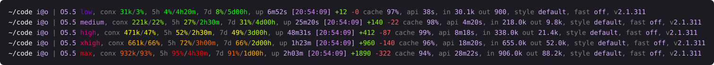

# statusline

A one-line, color-coded status line for [Claude Code](https://code.claude.com/docs/en/statusline): context use, 5-hour and 7-day usage limits with burn-rate warnings, session stats, and effort level.



## Install

Needs `bash`, `jq`, `awk` and GNU `date`.

```sh
curl -o ~/.claude/statusline.sh https://raw.githubusercontent.com/01-1/statusline/main/statusline.sh
```

Then add to `~/.claude/settings.json`:

```json
{
  "statusLine": {
    "type": "command",
    "command": "bash ~/.claude/statusline.sh"
  }
}
```

## What it shows

```
~/code i@o | O5.5 high, conx 341k/34%, 5h 47%/2h01m, 7d 43%/3d00h, up 48m31s [20:44:55] +412 -87 cache 99%, api 8m18s, in 338.0k out 21.4k, style default, fast off, v2.1.311
```

| Field | Meaning |
| --- | --- |
| `~/code i@o` | Current directory and user@host |
| `O5.5 high` | Model (first letter and version) and effort level |
| `conx 341k/34%` | Tokens in the current context and the share of the context window used |
| `5h 47%/2h01m` | 5-hour usage limit used, and time until it resets |
| `7d 43%/3d00h` | 7-day usage limit used, and time until it resets |
| `up 48m31s` | Session duration |
| `[20:44:55]` | Time of the last refresh |
| `+412 -87` | Lines added and removed this session |
| `cache 99%` | Share of input tokens served from the prompt cache |
| `api 8m18s` | Time spent waiting on the model |
| `in 338.0k out 21.4k` | Total input and output tokens |
| `style`, `fast`, `v` | Output style, fast mode, Claude Code version |

Fields missing from Claude Code's input are left out.

## Colors

- **Effort** goes from purple to red: `low`, `medium`, `high`, `xhigh`, `max`.
- **Used percentages** (context, 5h, 7d) go from green at 0% through yellow to red at 100%.
- **Reset countdowns** are colored by burn rate. The script compares the time until you'd hit 100% at your recent pace with the time until the limit resets. Twice as long or more is green, running out right at the reset is yellow, and running out well before it is red.

The burn rate is an exponential moving average of % per second, weighted over about the last 30 minutes for the 5-hour limit and the last day for the 7-day limit. It's saved between runs in `~/.cache/claude-statusline/`, and all sessions share it because the limits are per account.

The status line only redraws on Claude Code events, so the countdowns and burn rate can go stale while you're idle. Add `"refreshInterval"` to the `statusLine` setting to redraw on a timer.
